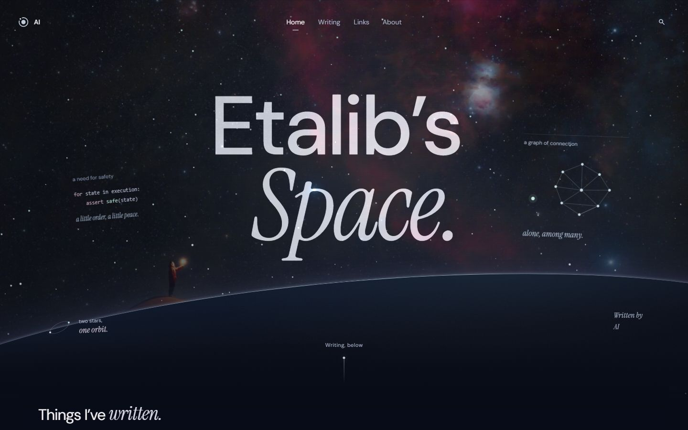
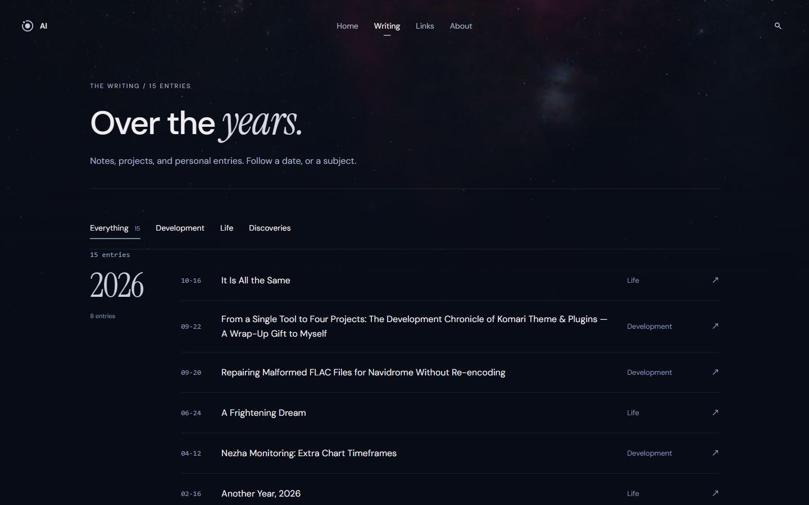
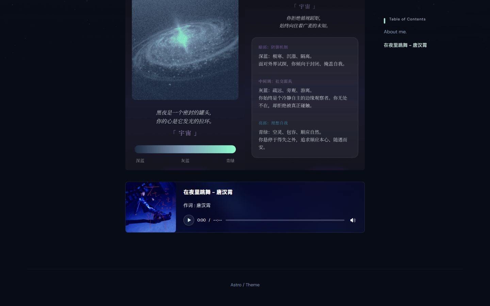

# Etalib’s Space

[English](README.md) | [简体中文](README.zh-CN.md)

A personal space for mathematics, code, and the rest of life. Built with [Astro](https://astro.build/), Etalib’s Space brings writing, music, and small interactive details together under a quiet, celestial design.

[**🖥️ Visit the blog**](https://www.etalib.space) · [**📖 Writing**](https://www.etalib.space/archive/) · [**🎵 About & music**](https://www.etalib.space/about/)



## ✨ The experience

**A little space to wander.** The Voyage interface pairs a photographic night sky, a planet’s horizon, subtle grain and stars with expressive serif and sans-serif typography. Home, Writing, Links and About share the same visual language while giving each page room to breathe.

**Motion with a sense of continuity.** Horizontal page transitions connect the main pages, while the Home title, editorial headings and article titles have their own carefully timed entrances. The Home lettering blends with the actual sky behind it. Keyboard, touch and browser history are supported, and reduced-motion preferences are respected.

**Writing that is easy to explore.** Browse by year or subject, filter and sort the home collection, search the production site with Pagefind, and return to a previous reading position. Responsive layouts bring the same character to smaller screens.



**Music, made part of the page.** Custom music cards combine cover art, colors sampled from the cover, a softly blurred background, timed scrolling lyrics and playback controls. They support uploaded audio as well as external audio links. [See one on About →](https://www.etalib.space/about/)



**A richer writing toolkit.** Markdown and MDX support mathematics, Mermaid diagrams, highlighted code, callouts, spoilers and image lightboxes. Articles can include media, and images, videos and embeds load lazily where appropriate. The writing dashboard offers forms for common components, image and audio uploads, draft management, and source editing for advanced content.

**Modern foundations, maintained deliberately.** The site currently runs on Astro 7.4, using static generation, Astro View Transitions and Pagefind. Responsive images and locally hosted Latin fonts support the experience; unit, integration and real-browser regression checks help protect it as the project evolves. Versions are pinned in the project rather than implied to be permanently latest.

## 🙏 Acknowledgements

This blog began with [Twilight](https://github.com/Spr-Aachen/Twilight), which provided a valuable foundation and helped the project get started. Thank you to Spr-Aachen and the contributors. Since then, the interface, motion, writing experience and much of the implementation have been extensively redesigned and developed independently. The project is maintained on its own, while retaining its upstream attribution and license.

---

## 📝 Writing & Maintenance

The writing dashboard and maintenance tools are part of this independently maintained blog.

### Write and publish online

Open [the writing dashboard](https://www.etalib.space/admin/) and sign in with your GitHub account. Complete the authorization on your first visit. The dashboard interface currently uses Chinese labels; the steps below describe their functions in English.

1. Select the **articles** collection to create a Markdown article, or the **MDX articles** collection for content that uses imports and custom layouts.
2. Fill in the title, publication date, summary, and category. Upload the cover and body images directly in the editor.
3. Use the **common component forms** for music cards, images, admonitions, spoilers, formulas, and Mermaid diagrams. Music cards support both uploads and existing external audio links; external audio does not need to be downloaded into the repository.
4. Keep the **draft** switch enabled and choose **Publish → Publish now** to save a draft. Turn the draft switch off before publishing an article publicly.

Online saves commit to `main` and trigger GitHub Actions deployment. A saved article appears on the website after deployment succeeds. Existing advanced Markdown and MDX use source editing to preserve their syntax; the final rendering is shown on the blog.

See [CMS_SETUP.md](CMS_SETUP.md) (Chinese) for the complete writing guide, music-card editing, and GitHub login configuration.

### Write locally

Requires Node.js 22.22+ and pnpm 10.29.2; use Node.js 24.13.0 to match CI.

```bash
corepack enable
pnpm install --frozen-lockfile
pnpm cms:local
```

Open <http://127.0.0.1:4321/admin/>. Local saves write articles and images into this checkout; they do not automatically commit or push to GitHub. Synchronize changes from GitHub before continuing locally after an online edit.

### Maintain and verify

Blog settings live in `twilight.config.yaml`, site content in `src/content`, and writing-dashboard collections in `public/admin/config.yml`. See [CMS_SETUP.md](CMS_SETUP.md) for the current authentication and deployment configuration.

```bash
pnpm test:unit
pnpm type-check
pnpm test:markdown
pnpm build
pnpm exec playwright install chromium
pnpm test:browser
```

Run these sequentially: integration and production builds both write `dist/`. Browser tests start their own production preview and compare real animation/interaction behavior and reviewed screenshots. `pnpm check` is an alias of the type check. The production output includes the Pagefind search index.

- [MAINTENANCE.md](MAINTENANCE.md): module ownership, motion regression history, development, CI/CD and troubleshooting.
- [Browser testing](tests/browser/README.md): viewport/engine coverage, animation evidence, golden review and failure diagnostics.
- [CMS_SETUP.md](CMS_SETUP.md): writing, media uploads, authentication, and deployment.

`src/`, `public/`, `cms/`, `scripts/`, and `tests/` contain maintained project files. `dist/`, `.astro/`, and `.vercel/` are generated output or local caches and can be removed when not in use. One-off investigation reports and logs stay out of Git.

OAuth credentials are stored in GitHub Actions encrypted Secrets and delivered to the server's `.env`. Keep local credentials out of Git. PRs run full validation; main pushes containing only posts or supported media build and deploy directly, while other changes run full validation first. Weekly/manual checks add browser engines. See the maintenance guide for workflow details and required Secrets.
