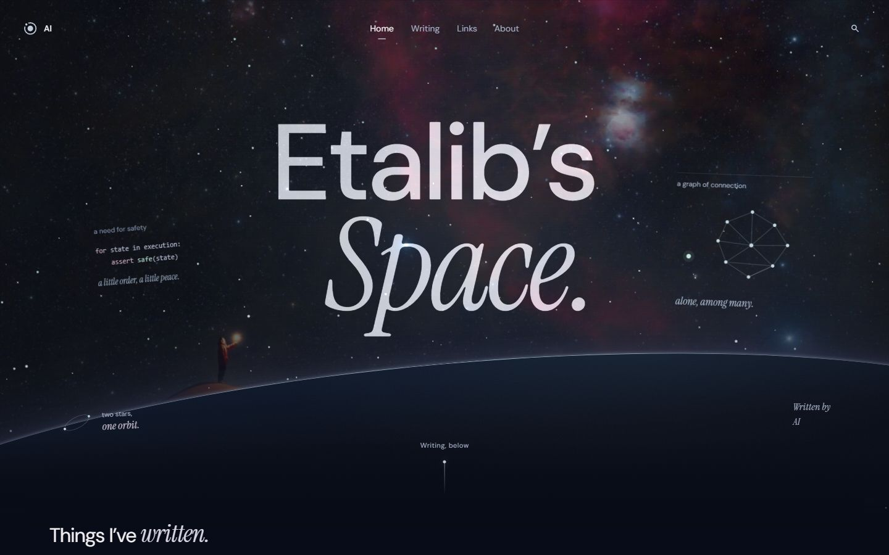
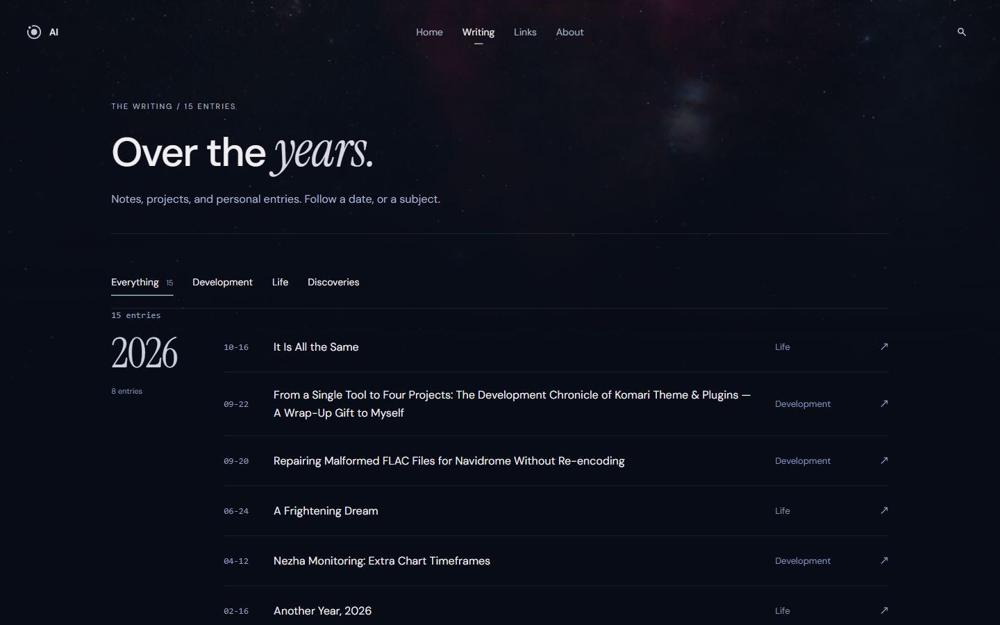
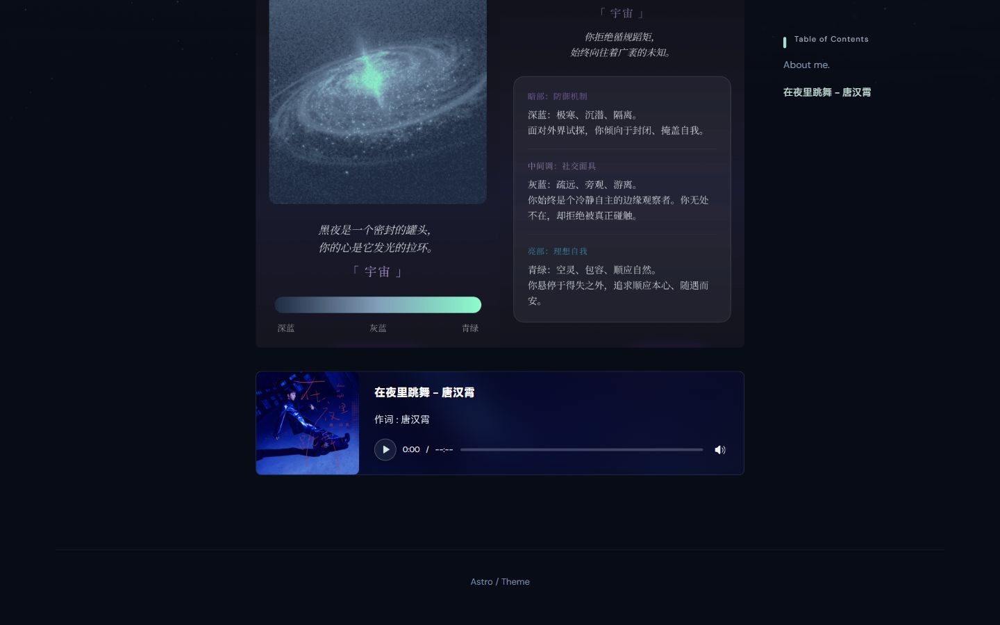

# Etalib’s Space

[简体中文](README.zh-CN.md) | [English](README.md)

一个记录数学、代码与生活的个人空间。博客基于 [Astro](https://astro.build/) 构建，将文字、音乐和细小的交互放进一片安静的星空。

[**🖥️ 访问博客**](https://www.etalib.space) · [**📖 文章归档**](https://www.etalib.space/archive/) · [**🎵 关于与音乐**](https://www.etalib.space/about/)



## ✨ 博客体验

**在星空中漫游。** Voyage 视觉语言以真实星空、星球地平线、细腻的纹理和星点为背景，结合无衬线与衬线艺术字。Home、Writing、Links 和 About 使用统一的设计语言，也各自保留适合内容的节奏。

**让动效保持连贯。** 主页面之间以横向滑动衔接，首页艺术字、内页标题和文章标题各有经过调整的入场与切换动效。首页文字与背后的真实星空混色；导航同时支持键盘、触摸、浏览器历史记录与减少动态效果设置。

**从容地寻找文章。** 按年份和主题浏览文章，在首页筛选、排序，通过 Pagefind 搜索，并在返回时恢复原来的阅读位置。响应式布局让不同屏幕上的阅读保持一致的气质。



**让音乐成为页面的一部分。** 自定义音乐卡片结合封面取色、柔和模糊背景、同步滚动歌词和播放控制，支持上传音频或使用已有外链。[前往 About 查看 →](https://www.etalib.space/about/)



**为写作准备更多工具。** Markdown 和 MDX 支持数学公式、Mermaid 图表、代码高亮、提示框、遮罩文字和图片灯箱；文章可嵌入媒体，图片、视频和嵌入内容在适用时延迟加载。写作后台提供常用组件表单、图片与音频上传、草稿管理，以及适合高级内容的源码编辑。

**保持现代，也认真维护。** 博客目前使用 Astro 7.4，结合静态生成、Astro View Transitions 和 Pagefind。响应式图片与本地拉丁字体服务于阅读体验；单元、集成和真实浏览器回归测试帮助保护持续演进中的交互与视觉效果。具体版本以项目锁定的依赖为准。

## 🙏 致谢

博客早期基于 [Twilight](https://github.com/Spr-Aachen/Twilight) 建立，它提供了宝贵的基础，也为项目起步带来了很多帮助。感谢 Spr-Aachen 和所有贡献者。此后，界面、动效、写作体验和大量实现都经过持续重做与独立开发；现在的博客由我独立维护，同时保留上游署名与许可。

---

## 📝 写作与维护

博客独立维护，下面介绍写作后台与日常维护方式。

### 在线写作与发布

打开[写作后台](https://www.etalib.space/admin/)，使用 GitHub 账号登录。首次访问时需要完成授权。

1. 选择**文章**创建 Markdown 文章；需要导入文件或自定义布局时，选择 **MDX 文章**。
2. 填写标题、发布日期、摘要和分类，直接在编辑器中上传封面和正文图片。
3. 使用**常用组件**表单插入音乐卡片、图片、提示框、遮罩文字、公式和 Mermaid 图表。音乐卡片支持直接上传，也支持已有的外部音频链接；外部音频无需下载到仓库中。
4. 新文章的**草稿**开关默认关闭，点击**发布 → 立即发布**即可公开文章。如需保存草稿，请先开启草稿开关再发布；已有草稿需要关闭开关才能公开。

在线保存会提交到 `main` 分支，并触发 GitHub Actions 自动部署。部署成功后，公开文章才会出现在网站上。已有高级 Markdown 和 MDX 使用源码编辑，以保留原有语法；最终效果以博客页面为准。

完整的写作步骤、音乐卡片编辑和 GitHub 登录配置见 [CMS_SETUP.md](CMS_SETUP.md)。

### 本地写作

需要 Node.js 22.22 及以上版本，以及 pnpm 10.29.2；使用 Node.js 24.13.0 可与 CI 保持一致。

```bash
corepack enable
pnpm install --frozen-lockfile
pnpm cms:local
```

打开 <http://127.0.0.1:4321/admin/>。本地保存会将文章和图片写入当前项目目录，不会自动提交或推送到 GitHub。在网页后台编辑之后，继续本地写作前应先同步 GitHub 上的新提交。

### 维护与检查

博客配置位于 `twilight.config.yaml`，网站内容位于 `src/content`，后台内容集合配置位于 `public/admin/config.yml`。当前认证与部署配置见 [CMS_SETUP.md](CMS_SETUP.md)。

```bash
pnpm test:unit
pnpm type-check
pnpm test:markdown
pnpm build
pnpm exec playwright install chromium
pnpm test:browser
```

按顺序执行：Markdown 集成检查和生产构建都会写入 `dist/`，不能并行。浏览器测试会自行启动生产预览，验证真实动画、交互和已审查的截图基线。`pnpm check` 是类型检查的别名，无需重复执行。生产产物包含 Pagefind 搜索索引。

- [MAINTENANCE.md](MAINTENANCE.md)（英文）：模块职责、动画回归历史、开发方式、CI/CD 和故障排查。
- [浏览器测试指南](tests/browser/README.md)（英文）：屏幕尺寸与浏览器覆盖、动画证据、基线审查和失败诊断。
- [CMS_SETUP.md](CMS_SETUP.md)：写作、媒体上传、认证与部署说明。

`src/`、`public/`、`cms/`、`scripts/` 和 `tests/` 是持续维护的项目文件。`dist/`、`.astro/` 和 `.vercel/` 是构建产物或本地缓存，不使用时可以删除。一次性排查报告和日志不纳入 Git。

OAuth 凭据保存在 GitHub Actions 加密 Secrets 中，并在部署时写入服务器的 `.env`，不要提交到 Git。PR 自动运行完整验证；main 上的纯文章或支持的媒体更新构建后部署，其他改动通过完整验证后再部署。每周和手动扩展检查增加浏览器引擎，具体触发条件、Secrets 和排查方法以维护指南为准。
