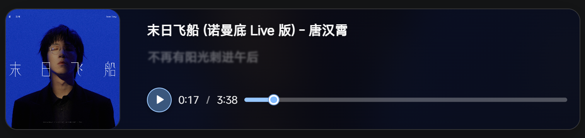

# Blog

[简体中文](README.zh-CN.md) | [English](README.md)

一个基于 Astro 框架、集成内容管理后台的静态博客，修改自 [Twilight 上游项目](https://github.com/Spr-Aachen/Twilight)。

[**🖥️ 在线演示**](https://www.etalib.space)
[**📝 上游文档（英文）**](https://docs.twilight.spr-aachen.com/en)

## ✨ 特性

在上游项目的基础上，我做了一些修改并增加了新特性：

1. **音乐卡片**
   支持**高斯模糊**、**封面取色**、**生动的歌词滚动动画**、**歌曲封面**和**可自定义的播放进度条**。具体效果见[演示页面](https://www.etalib.space/about/)。

   

2. 移除翻译和主题切换。

3. 将友情链接页改为链接页。

4. 优化技能卡片。

5. **媒体懒加载**
   为 Markdown 和 MDX 中的图片、视频及内嵌页面集成自动懒加载。

6. **关闭展示模块**
   关闭展示模块及其导航入口，防止相关页面和资源加载。

## 🙏 致谢

[Twilight 上游项目](https://github.com/Spr-Aachen/Twilight)

---

## 📝 写作与维护

本博客独立维护。上文介绍个人新增的特性，下文说明当前写作后台的使用方法和维护流程。

### 在线写作与发布

打开[写作后台](https://www.etalib.space/admin/)，使用 GitHub 账号登录。首次访问时需要完成授权。

1. 选择**文章**创建 Markdown 文章；需要导入文件或自定义布局时，选择 **MDX 文章**。
2. 填写标题、发布日期、摘要和分类，直接在编辑器中上传封面和正文图片。
3. 使用**常用组件**表单插入音乐卡片、图片、提示框、遮罩文字、公式和 Mermaid 图表。音乐卡片支持直接上传，也支持已有的外部音频链接；外部音频无需下载到仓库中。
4. 保持**草稿**开关开启，点击**发布 → 立即发布**即可保存草稿。准备公开文章时，先关闭草稿开关再发布。

在线保存会提交到 `main` 分支，并触发 GitHub Actions 自动部署。部署成功后，公开文章才会出现在网站上。已有高级 Markdown 和 MDX 使用源码编辑，以保留原有语法；最终效果以博客页面为准。

完整的写作步骤、音乐卡片编辑和 GitHub 登录配置见 [CMS_SETUP.md](CMS_SETUP.md)。

### 本地写作

需要 Node.js 22.22 及以上版本，以及 pnpm 10.29.2。

```bash
pnpm install
pnpm cms:local
```

打开 <http://127.0.0.1:4321/admin/>。本地保存会将文章和图片写入当前项目目录，不会自动提交或推送到 GitHub。在网页后台编辑之后，继续本地写作前应先同步 GitHub 上的新提交。

### 维护与检查

博客配置位于 `twilight.config.yaml`，网站内容位于 `src/content`，后台内容集合配置位于 `public/admin/config.yml`。当前认证与部署配置见 [CMS_SETUP.md](CMS_SETUP.md)。

```bash
pnpm check
pnpm test:unit
pnpm test:markdown
pnpm build
```

Markdown 集成检查完成后，需要再运行一次正常构建，避免临时测试页面进入正式产物。生产输出目录为 `dist/`，其中包含 Pagefind 搜索索引。

- [MAINTENANCE.md](MAINTENANCE.md)（英文）：保留功能与维护边界。
- [CMS_SETUP.md](CMS_SETUP.md)：写作、媒体上传、认证与部署说明。

`src/`、`public/`、`cms/`、`scripts/` 和 `tests/` 是持续维护的项目文件。`dist/`、`.astro/` 和 `.vercel/` 是构建产物或本地缓存，不使用时可以删除。一次性排查报告和日志不纳入 Git。

OAuth 凭据保存在 GitHub Actions 加密 Secrets 中，并在部署时写入服务器的 `.env`。不要把本地凭据提交到 Git。现有 VPS 部署使用 Docker、Nginx 和 GitHub Actions。
