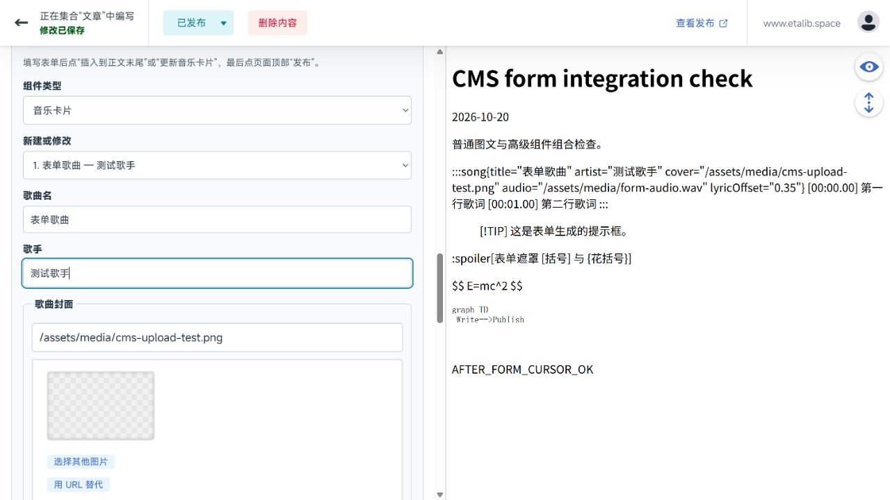

# 正式写作后台与清理交付

日期：2026-10-20。项目已完成清理和正式后台实现。本报告记录本地验收；线上部署结果以 [GitHub Actions](https://github.com/Chen017/Blog/actions/workflows/deploy.yml) 对应提交的运行结果为准。

## 完成内容

- 按确认的边界移除不用的页面、组件、配置、专属资源和依赖。15 篇真实文章、原有地址和图片引用保留，6 份 Skills 数据保留。
- Twikoo/Waline、公式、Mermaid、密码文章、复制限制、自动 OG 能力保留。删除文章许可证展示、公告、页脚 HTML 注入、上游 music/GitHub 卡片等已确认废弃功能。详细模块清单见历史 [IMPLEMENTED.md](IMPLEMENTED.md)。
- 后台使用正确的 `Chen017/Blog` / `main`，新建文章和图片自动进入对应目录，草稿默认开启。
- 常用组件表单支持 **音乐卡片、图片、提示框、spoiler、公式、Mermaid**。音乐卡片可新建，也能读取并修改现有卡片；保留 LRC 歌词、偏移和未编辑的文章内容。
- 歌曲封面和音频可直接上传，也可填写已有外部链接。外部音频继续在播放时加载，不下载到仓库或打包进构建。上传文件使用公共媒体地址；普通正文图片保持同目录引用。新增音频类型判断，MP3、WAV、M4A 等使用对应类型，原有 MP3 行为保持。
- 高级内容仍使用源码，表单插入后编辑器同步更新，继续输入不会覆盖刚插入的组件。普通文章保留富文本能力。
- GitHub OAuth 服务、Nginx 路由和部署配置已接入。经用户明确授权，Client ID/Secret 已保存到仓库的 GitHub Actions 加密 Secrets；部署会写入服务器 `.env`。源码、浏览器文件和镜像不包含凭据。
- 原 `.env` 是被 Git 跟踪的空配置文件；现已停止跟踪并保留本地文件，加入忽略规则与无密钥 `.env.example`，避免新填写的凭据进入提交。发布文件凭据扫描通过。
- 部署会同步删除旧代码，并保留服务器环境文件、Git、依赖与缓存。Debian/Ubuntu 的 root 部署会自动补装 rsync；部署检查同时覆盖静态网站和 `/oauth/health`。

## 验证结果

| 检查 | 结果 |
| --- | --- |
| 真实内容完整性 | 58 个保留文件逐字节未变，7 个示例文件完整归档，6 份 Skills 数据保留 |
| 自动检查 | 21 项单元检查全部通过 |
| 静态检查 | 0 errors、0 warnings、24 hints |
| Markdown / MDX 组件构建 | 公式、Mermaid、歌曲、提示框、spoiler、图片和代码控制通过；表单生成的含引号、花括号歌名也通过 |
| 浏览器表单验证 | 新建歌曲、修改现有歌曲、封面/音频/正文图片上传、六类组件插入、保存草稿均通过 |
| 保存后隔离构建 | 六类组件完整渲染，上传音频在输出目录中，图片路径有效，源码继续输入后各组件仍完整 |
| 正式构建 | 25 页，Pagefind 索引 16 页；不包含任何测试文章 |
| 评论、密码、OG | 第一阶段的双评论系统、密码解密与 1200×630 OG 隔离验证保留通过记录 |
| 配置、凭据 | YAML 可解析，发布文件扫描未发现实际凭据 |

表单验收结果见 `implementation/component-form-results.json`；其他结果与截图在 `implementation/`。构建日志保留在本机，未加入 Git。表单复核脚本依赖本次 `.astro/cms-stage2/` 隔离副本。

## 之后怎么写

打开 [文章管理](https://www.etalib.space/admin/)，用 Chen017 登录。选“文章”新建，填标题、日期和正文；插图或歌曲用“常用组件”。保持“草稿”开启并点击“发布”可保存草稿；准备公开时关闭“草稿”，再点击“发布”。后台提交到主分支，等待部署成功即可。

完整写作步骤与维护方法见根目录 [CMS_SETUP.md](../../CMS_SETUP.md)。首次 GitHub 登录授权由用户本人完成，不通过自动化替用户确认；真实账号授权回调和线上发布文章仍需首次使用时验证。后台预览不执行完整 Astro/MDX，最终效果以博客页面为准。
