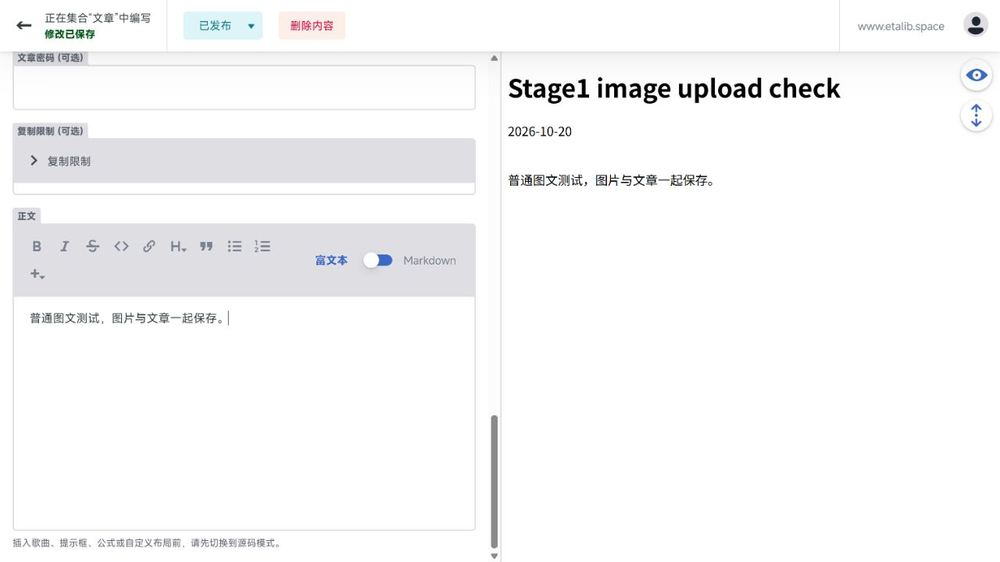

# 清理与写作后台实施报告

> 这是第一阶段的历史验收记录。后续组件表单、正式凭据接入和主分支交付结果见 [DELIVERY.md](DELIVERY.md)。

日期：2026-10-20。**本地实施和验证完成，供审查；尚未提交、推送 GitHub 或部署线上。**

本报告接续同目录的初步 `REPORT.md`。后者记录清理前的现状与建议，本报告记录实际修改和验收结果。

## 结论

已按确认的功能边界清理项目，并落地第一阶段 Decap 后台。普通图文可以富文本编辑；已有高级 Markdown 会自动进入源码模式，MDX 始终使用源码。上传图片后会与文章一起保存到文章目录，不需要手动建目录、搬图片。

本地入口已经实际启动验证：运行 `pnpm cms:local` 后访问 `http://127.0.0.1:4321/admin/`。本地保存直接写入项目文件，不会自动提交 GitHub。线上后台和认证服务代码已准备好，但 **GitHub OAuth 的 Client ID/Secret 仍为空，真实授权、提交和自动部署的全链路尚未验收**。

## 实际保留

| 功能 | 处理与证据 |
| --- | --- |
| 15 篇真实文章、现有图片、About、Links | 文件哈希核对通过，现有内容原样保留；没有迁移文章地址 |
| Skills 页面、6 份技能数据 | 页面继续生成，6 份数据逐字节未变；后台也保留技能集合 |
| 自己的 `:::song` | 原渲染插件未修改，相关样式、播放控制、歌词、取色和背景保留；构建检查通过 |
| Twikoo、Waline | 两套实现、配置和原有评论组件均保留；分别启用后进行隔离构建，并验证文章级关闭评论 |
| 公式、Mermaid、提示框、spoiler | Markdown 与 MDX 的构建验证通过；源码编辑避免自定义语法被重写 |
| 密码文章、复制限制 | 配置、字段和运行代码保留；隔离文章确认公开 HTML 不含测试正文，并能用密码解密 |
| 自动 OG 图片 | 仍按原配置默认关闭，能力保留；隔离开启后成功生成 1200×630 PNG，包含中文标题 |
| 分类、归档、搜索、RSS/Atom、文章目录 | 保留，正式构建与输出检查通过；删除的是旧侧栏目录组件，文章 TOC 仍在 |
| 当前外观和部署能力 | 固定深色、MiSans、壁纸、粒子、响应式图片、Umami、VPS/Docker 部署与缓存清理保留 |
| 原项目署名与许可证文件 | 保留；删除的是每篇文章的许可证展示模块 |

## 实际删除或移出生产内容

| 范围 | 处理 |
| --- | --- |
| 上游 `:::music`、GitHub 卡片 | 删除注册、渲染插件及专用样式；不影响自己的 song |
| 公告、文章许可证展示、页脚 HTML 注入 | 删除组件、配置和注入文件；正常页脚保留 |
| Vercel、ESA、Front Matter 编辑器配置 | 删除对应文件与已不用的配置 |
| Exhibition、Albums、Anime、Diary、Projects、Timeline | 删除不用的独立路由、对应数据和组件；构建产物确认不再生成 |
| 全局音乐播放器、Pio、加载遮罩、明暗切换、翻译切换 | 删除相关组件、配置及不用的静态资源，继续使用当前深色外观 |
| 旧标签展示与筛选、旧侧栏目录 | 删除界面、运行逻辑及公开列表里的标签数据 |
| 6 篇上游示例草稿与封面 | 移到 `tests/fixtures/content/`，保留测试参考，不再进入正式内容加载器 |
| 上游维护说明与不用的依赖 | README 改成个人项目说明，删除上游同步指南；移除不用的相册、滚动、字体及旧 OAuth 集成依赖 |

静态页面数从 **31 页变为 25 页**：移除旧页面，增加独立 `/admin/` 后台。Pagefind 仍索引 **16 页**。

## 对历史数据和内部文案层的判断

- **旧文章标签及已不用的扩展字段：** 删除类型、Schema、展示和筛选中不再使用的部分；历史 Markdown 中的原始字段不批量改写，保留内容文件的完整性。链接集合自身的 tags 不属于文章标签功能，继续保留。
- **有效文章字段：** 保留简短标题、日期、封面、分类、固定地址、草稿、评论、语言标记、密码和复制限制。后台表单对应这些字段。
- **内部 i18n：** 移除语言切换、浏览器语言检测和不用的中日文词典，收敛为当前英文界面的小型集中字典，避免全项目重复硬编码文案。后台本身使用中文。
- **暂时保留：** 旧评论组件与评论能力一并保留；旧文章原始元数据保留；上游 Git remote 未改动，但维护文档已明确不再同步上游。没有因配置为 false 就删除用户指定保留的能力。

## Decap 编辑验证

固定使用 Decap **3.17.1**，避免浮动版本改变编辑行为。以下保存测试均通过官方本地文件代理执行，目标是 `.astro/cms-stage1/` 内的文章副本，未修改真实文章。

| 样本 | 编辑方式 | 保存与构建结果 |
| --- | --- | --- |
| 《其实是一样的》 | 富文本 | 正常保存；分隔线 `---` 被规范化为 `- - -`，渲染 HTML 一致，2 个相对图片引用可解析 |
| 《2026新年 New Year》 | 自动源码模式 | 除附加测试标记外，正文完全一致；song 和 spoiler 保留，3 个相对图片引用可解析，构建通过 |
| 《Music players with elegant animations》 | 强制源码模式 | 除附加测试标记外，正文完全一致；11 个图片 import 和自定义布局保留，构建通过 |
| 新建图文测试文章 | 富文本、图片上传 | 自动创建 `stage1-image-upload-check/index.md`，图片保存为同目录 `cms-upload-test.png`，封面引用为相对文件名；新文章默认草稿 |

另外将上述保存副本构建为隔离网站，在测试副本内关闭新文章的草稿并开启正文封面，确认新上传图片可被处理并显示。该隔离网站生成 26 页，**正式交付构建仍为 25 页，不含测试文章**。

重要编辑边界：普通富文本会规范化 Markdown 格式；要新插入 song、公式、Mermaid、提示框或自定义布局，应先切到源码。已有高级语法自动锁定源码，防止切回富文本破坏语法。后台预览不执行完整 Astro/MDX 渲染；音乐卡片专门表单按约定留到下一阶段。

## 认证与部署修改

- 线上仓库修正为 `Chen017/Blog` 的 `main`，后台配置不包含本地代理开关。
- 移除旧 OAuth 集成，增加独立认证服务；Secret 只从服务器环境读取。采用固定回调地址、浏览器绑定的一次性 state、PKCE、精确来源校验，并检查允许账号和仓库写权限。
- GitHub `public_repo` 的授权范围不局限于这一个仓库，已在设置文档说明。实际登录凭据仍缺失。
- 部署改为上传到独立中转目录后同步到 `/root/Blog`，使本次删除的旧代码也会从服务器工作目录移除。保留服务器 `.env`、Git、依赖和缓存目录。
- VPS 新增 `rsync` 前置要求，流程会先检查再同步；本次没有连接 VPS，也没有验证远端是否已安装。

一次性设置和日常写作步骤见项目根目录 `CMS_SETUP.md`。认证实现参考 [Decap 外部 OAuth 文档](https://decapcms.org/docs/external-oauth-clients/) 与 [GitHub OAuth 流程](https://docs.github.com/en/apps/oauth-apps/building-oauth-apps/authorizing-oauth-apps)。

## 验收与限制

| 检查 | 结果 |
| --- | --- |
| 内容哈希 | 58 个保留文件原样未变；7 个文件完整归档；5 个废弃功能示例文件删除 |
| `pnpm check` | 0 errors、0 warnings、24 hints |
| `pnpm test:unit` | 14/14 通过，含高级语法源码保护、本地代理隔离和 OAuth 检查 |
| `pnpm test:markdown` | Markdown/MDX 中公式、Mermaid、song、spoiler、代码控制均通过 |
| 双评论系统、密码、OG 隔离构建 | Twikoo/Waline 两轮均通过 |
| 后台保存副本构建 | 图文、song、MDX、新封面均通过 |
| 最终 `pnpm build` | 25 页、Pagefind 16 页，必需产物与旧路由移除检查通过 |
| YAML 配置 | 后台、博客、Docker Compose、GitHub Actions 均能解析 |
| 本地后台启动 | `pnpm cms:local` 已实际启动页面与本地文件代理，并验证页面加载 |
| Docker/Nginx 容器、线上登录与部署 | 本机没有 Docker，未验证容器启动；线上凭据为空，未完成真实 GitHub 授权/推送/部署 |

可审查证据放在 `implementation/`，包括内容/编辑结果、评论/密码/OG 结果、构建日志、检查日志和截图。`scripts/` 保留复核脚本；其中编辑保存的复核脚本依赖本次 `.astro/cms-stage1/` 隔离副本。

项目进入独立维护后的保留边界和常规验证步骤已写入根目录 `MAINTENANCE.md`。
