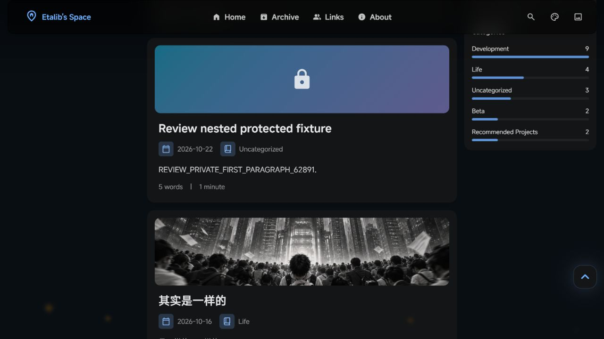

# 全仓代码审查 · 2026-10-22

> 此报告记录修复前的基准状态；修复后的结果见 [修复记录](FIXES.md)。

审查基准：`3cf300a`。发现 **13 项可修复问题：4 项 P1、9 项 P2**。P1 建议优先修复；P2 涉及功能正确性及检查工具。结论区分实际构建/浏览器复现与配置开启后触发的问题。

范围覆盖 `src/` 的页面、组件、CMS 模型、Markdown 插件及工具，`public/admin/`，`cms/`，`scripts/`，测试、配置和部署工作流；检查历史 audit 脚本的用途与文件操作。第三方压缩文件及依赖没有逐行审查，依赖另做生产依赖公告扫描。没有执行真实 GitHub 登录、发布文章或 VPS 部署。

业务代码保持原样，本次新增内容仅在 `audit/2026-10-22/`。临时文章已删除，正式内容已重新构建，临时预览服务已停止。

## 检查结果

| 检查 | 结果 |
| --- | --- |
| `pnpm test:unit` | 42/42 通过 |
| `pnpm check` | 91 个文件，0 errors、0 warnings、24 hints |
| `scripts/test-markdown.mjs` | Markdown/MDX 的公式、Mermaid、歌曲、spoiler 和代码控件通过实际构建验证 |
| 正常 `pnpm build` | 通过；25 个页面，Pagefind 索引 16 个页面，产物验证通过 |
| 临时文章生产构建 | 已复现 F01、F02、F05；正文和订阅中的保密处理分别验证 |
| 本地生产预览 | 已复现 F03、F10，并确认首页摘要泄漏及错误地址 |
| `pnpm type-check` | 失败，45 条 TypeScript 诊断，见 F11 |
| `pnpm audit --prod --json` | 2 moderate、1 low，0 high、0 critical；见依赖说明 |

首次受限环境构建因无法获取公开 GitHub 封面失败；允许联网后原配置正常构建成功，未将该环境限制计为项目缺陷。

## P1

### F01 · 开启加密但密码为空时发布明文

位置：[文章路由第 66 行](/D:/Code/my-twilight-blog/src/pages/posts/[...slug].astro:66)，[schema 第 37 行](/D:/Code/my-twilight-blog/src/content.config.ts:37)。

`isEncrypted` 同时依赖 `encrypted` 和非空 `password`，而 schema 和 CMS 都允许密码留空。因此 `encrypted: true`、`password: ''` 能通过构建，正文进入普通 `<slot>`，页面甚至不显示密码输入框。这是保护功能的失败开放行为。

复现：临时文章的 `REVIEW_UNPROTECTED_BODY_74821` 出现在静态正文中，`passwordPromptPresent=false`。建议在构建和 CMS 校验中拒绝“启用加密但密码为空”的状态。

### F02 · 加密文章的首段泄漏到首页摘要

位置：[postCard.astro 第 73 行](/D:/Code/my-twilight-blog/src/components/post/postCard.astro:73)。

摘要为空时，卡片直接输出 `remarkPluginFrontmatter.excerpt`，没有检查 `entry.data.encrypted`。摘录插件从未加密 Markdown 的首段取文本，因此文章页虽只包含密文，首页仍公开首段；`line-clamp` 只影响显示，不会从 HTML 中移除其余文本。

复现：有有效密码的临时文章在首页显示 `REVIEW_PRIVATE_FIRST_PARAGRAPH_62891`；其文章页无该明文，RSS/Atom 也正确排除了该文章。建议加密文章只使用作者明确填写的公开摘要，或统一显示密码保护提示。

### F03 · 目录将已转义的标题代码重新解析成 HTML

位置：[toc.ts 第 271 行](/D:/Code/my-twilight-blog/src/components/sidebar/toc.ts:271)。

`getPageHeadings()` 使用 `textContent` 提取标题，随后 `regenerateTOC()` 将 `heading.text` 拼进字符串并赋给 `innerHTML`。原本安全的标题行内代码会因此被当作真实标签解析，既破坏目录文字，也能执行事件处理器。

复现：标题用反引号包住 ``。文章正文正确显示代码，而浏览器中的目录生成了 4 个 `img[onerror]`，DOM 测试标记变为 `executed`。测试仅设置本地 DOM 属性。建议使用 `createElement`/`textContent` 组装目录，同时安全设置链接属性。

### F04 · 启用 Umami 统计时把 API key 写入公开 HTML

位置：[postMeta.astro 第 96 行](/D:/Code/my-twilight-blog/src/components/post/postMeta.astro:96)，[profile.astro 第 59 行](/D:/Code/my-twilight-blog/src/components/sidebar/profile.astro:59)。

两个组件都把 `umamiApiKey` 输出到 `data-umami-api-key`，浏览器再携带它访问 API。真实 key 即使从构建环境变量读取，也会进入静态 HTML 和请求头，访客可以复制它并访问该 key 获准访问的数据。Umami 官方将 API key 定义为访问账户数据的认证凭据，详见 [官方说明](https://docs.umami.is/docs/cloud/api-key)。

当前该功能关闭且配置 key 为空；开启统计并配置真实 key 后触发。建议通过服务端代理或构建期读取统计，只公开结果，或使用专门的公开分享机制。

## P2

### F05 · 固定地址的归一化不一致，生成指向 404 的链接

位置：[url.ts 第 31 行](/D:/Code/my-twilight-blog/src/utils/url.ts:31)，路由处理在 [文章路由第 46 行](/D:/Code/my-twilight-blog/src/pages/posts/[...slug].astro:46)。

路由生成器允许并去除固定地址中的 `posts/` 前缀，但 `getPostUrlByRouteName()` 只去除前导斜杠。`routeName: posts/review-custom/` 实际生成 `/posts/review-custom/`，首页、归档和订阅却链接到 `/posts/posts/review-custom/`，该路径不存在。

已用生产构建及浏览器确认。建议路由生成和所有链接共用同一个规范化函数，并校验地址冲突。

### F06 · Waline 的 ESM 文件作为普通脚本加载

位置：[waline.astro 第 18 行](/D:/Code/my-twilight-blog/src/components/comment/waline.astro:18)。

引用的 `dist/waline.js` 含 ESM `export`，当前 `<script is:inline src=...>` 是 classic script。启用 Waline 后会产生语法错误，`Waline` 全局对象不会建立，而初始化函数会每 500ms 继续重试。

已读取实际 CDN 文件，并核对 [Waline 官方文件说明](https://waline.js.org/en/reference/client/file.html)：该路径为 ESM，`waline.umd.js` 才是 UMD。建议使用 module import，或选择匹配现有全局调用方式的 UMD 文件。当前全局评论关闭。

### F07 · Twikoo 在一次普通加载中初始化两次

位置：[twikoo.astro 第 54 行](/D:/Code/my-twilight-blog/src/components/comment/twikoo.astro:54)，以及第 70 行的自定义事件监听。

组件同时响应 `DOMContentLoaded` 和 `twilight:page:loaded`；主布局在同一次加载期间也会调用 `announcePageReady()`。两个入口都无运行中/已完成保护，并清空同一个容器后发起 `twikoo.init()`，形成并发挂载和重复请求。

使用原组件脚本模拟这两个实际加载事件，`init` 调用次数为 2。建议统一生命周期入口，并用初始化状态或实例管理避免重复挂载。当前全局评论关闭。

### F08 · RSS 和 Atom 把 MDX 源代码作为正文发布

位置：[rss.xml.ts 第 33 行](/D:/Code/my-twilight-blog/src/pages/rss.xml.ts:33)，[atom.xml.ts 第 55 行](/D:/Code/my-twilight-blog/src/pages/atom.xml.ts:55)。

两个 feed 都直接用普通 `MarkdownIt` 渲染 `post.body`。现有 MDX 文章的 `import saltImg1 from ...` 会显示成正文，`` 变成转义代码，12 张 JSX 图片不能正常显示。自定义 directive 也没有进入网站实际的渲染链路。

已在正常文章的实际 RSS/Atom 产物中确认。建议复用文章渲染结果并进行 feed 所需的清洗；至少为 MDX 提供经过明确处理的正文/摘要。

### F09 · feed 中的 `../` 图片按错误目录解析

位置：[rss.xml.ts 第 60 行](/D:/Code/my-twilight-blog/src/pages/rss.xml.ts:60)，Atom 第 82 行有相同逻辑。

代码把任意 `../` 图片硬编码映射到 `/src/content/`。例如 `posts/review-relative/index.md` 引用 `../to-feel-not-fight/image.png`，正确目标是 `/src/content/posts/to-feel-not-fight/image.png`，实际查找却少了 `posts/`。查找失败后保留相对地址，订阅阅读器通常无法加载。

已对原 RSS `GET` 函数注入文章和图片加载器验证，错误查找路径及原样输出都记录在 `unit-probe-results.json`。建议基于真实 Markdown 文件目录规范化路径，支持多级 `../`。

### F10 · 加密文章解锁后图片灯箱未初始化

位置：[fancybox.ts 第 35 行](/D:/Code/my-twilight-blog/src/utils/fancybox.ts:35)，[解锁事件第 111 行](/D:/Code/my-twilight-blog/src/components/common/passwordProtection.astro:111)。

页面初载时，加密正文尚未进入 DOM；如果没有明文封面或其它可绑定图片，`initFancybox()` 会直接返回。解锁只触发 `resize` 和 `content-decrypted`，而 Fancybox 没有监听解锁事件，因此图片出现后仍然没有绑定。

浏览器输入测试密码后正文和目录正常恢复，但 Fancybox 样式列表为空，点击正文图片后的灯箱数量仍为 0。建议解锁后运行对应的初始化逻辑，并使初始化可安全重复调用。

### F11 · 单独的 `type-check` 脚本始终失败

位置：[package.json 第 10 行](/D:/Code/my-twilight-blog/package.json:10)，[tsconfig.json 第 2 行](/D:/Code/my-twilight-blog/tsconfig.json:2)。

在当前锁定依赖和生成类型下，`tsc --noEmit --isolatedDeclarations` 报告 45 条错误后退出 2，包括 Astro 生成声明与包内声明冲突、重复 `CssVariable`、缺失 React 类型及 `unstorage` 可选驱动类型。与此同时，`pnpm check` 能通过，两个公开检查入口给出相反的成功状态。

完整输出在 `type-check.log`。建议统一为项目支持的 Astro 检查入口，或调整 tsconfig/依赖声明检查策略，使该脚本成为可用的检查门槛。

### F12 · 归档按访客时区改变发布日期和归属年份

位置：[archivePanel.svelte 第 42 行](/D:/Code/my-twilight-blog/src/components/archivePanel.svelte:42)，第 86 行的年份分组同样受影响。

CMS 的日期是 `YYYY-MM-DD`，内容层生成 UTC 零点的 Date；归档用浏览器本地 `getMonth()`、`getDate()`、`getFullYear()` 处理。美洲等 UTC 负偏移地区会显示前一天，1 月 1 日文章甚至被分到前一年，与文章页的 ISO 日期不一致。

在 `TZ=America/Los_Angeles` 下，`2025-01-01T00:00:00Z` 被归为 `2024-12-31`。建议日期展示和年份分组统一保留原始日历日期，或明确使用一致的 UTC/站点时区。

### F13 · 命令行新建文章默认直接公开

位置：[new-post.js 第 52 行](/D:/Code/my-twilight-blog/scripts/new-post.js:52)。

项目说明要求新内容默认草稿，CMS 也使用 `draft: true`，但公开的 `pnpm new-post` 脚本生成 `draft: false`。用户提交同步生成的未完成文章时，会立即进入生产页面、订阅和搜索索引。

执行原脚本并替换文件写入为测试捕获后，确认模板为 `draft: false`。建议 CLI 与 CMS 共用草稿优先的默认值；同时统一到现行 `<slug>/index.md` 目录规范，减少维护分歧。

## 依赖公告

`pnpm audit --prod` 返回 3 个受影响安装路径，对应 2 个公告；它们未计入上面的 13 项应用代码问题。

- `katex@0.16.47`：low，[GHSA-238p-pmpm-9mq7](https://github.com/advisories/GHSA-238p-pmpm-9mq7)，修复版本 `>=0.18.2`。利用依赖已有 prototype pollution 或可控选项对象原型；本次未发现这条前置利用链，不能据此认定当前公式输入可直接执行脚本。
- `postcss-selector-parser@6.1.4`、`6.0.10`：moderate，[GHSA-rj75-hqrm-r3gf](https://github.com/advisories/GHSA-rj75-hqrm-r3gf)，修复版本 `>=7.1.6`。公告明确普通可信源的构建期用途不受攻击场景影响；当前两个路径来自 Expressive Code/PostCSS 和 Tailwind Typography，建议随兼容依赖升级处理。

原始机器结果见 `dependency-audit.json`。不建议仅为消除数量而跨主版本强制覆盖传递依赖。

## 复现材料

- `review-probes.mjs`：创建临时文章，调用项目的真实 Markdown/MDX 构建测试，记录 `probe-results.json`，通过 `finally` 清理源文件。
- `review-unit-probes.mjs`：执行原 TOC、Twikoo、RSS 和新建文章脚本的隔离用例，生成 `unit-probe-results.json`。需要先运行前一个脚本。
- `browser-results.json`：本地生产预览的观察结果；图片证据为 `protected-excerpt-leak.png` 和 `unlocked-image-no-viewer.png`。
- `probe-build.log`、`normal-build.log`、`type-check.log`：构建与类型检查原始日志。日志文件被项目既有忽略规则排除出 Git。

重新运行审查构建用例后，应再运行正常 `pnpm build`，确保临时页面不进入发布产物。本次已完成这一步，并确认正式文章目录、输出目录、sitemap 中均无 `review-*` 或 `beta-regression-*` 测试页面。
